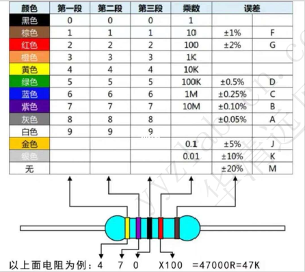
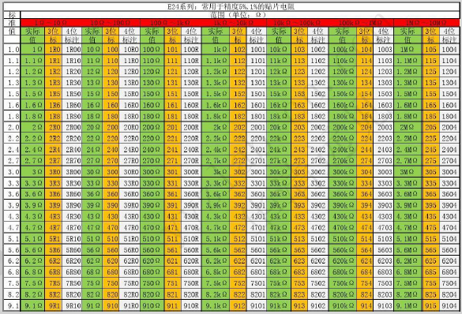
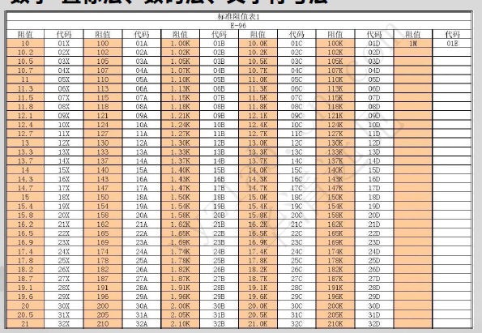
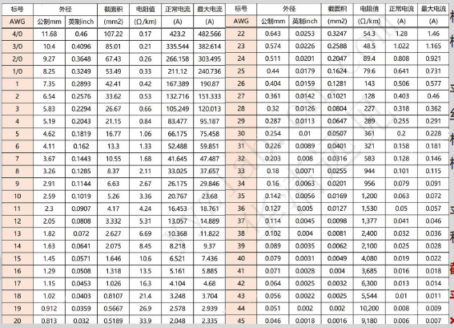
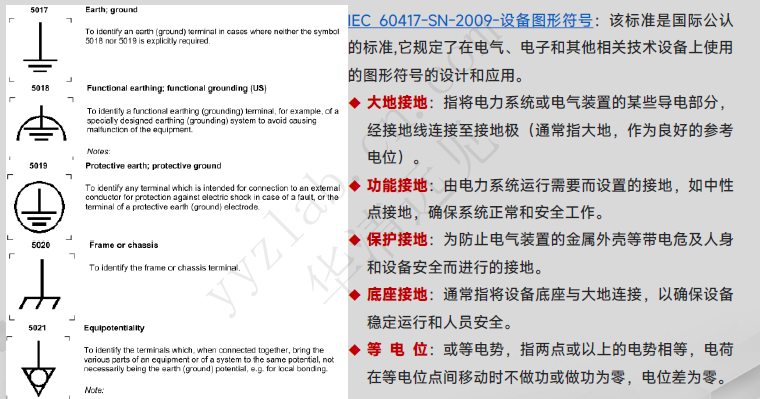
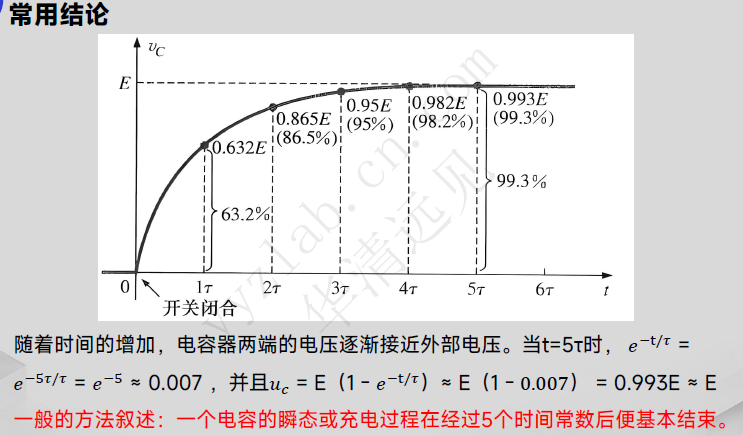

# 电子电路基础笔记

## 一、原理图与PCB基础
### 1. 原理图电路标识
- **网络标号**：电气连接标识符，相同网络标号代表电气上直接相连。
- **导线**：实现元器件之间电气连接。
- **线条/图形框**：仅做绘图装饰，**无电气连接属性**。
- **引脚**：芯片、器件对外电气接口，用于传递电流与信号。

### 2. PCB（印制电路板）
> Printed Circuit Board
- 分类：单面板、双面板、多层板、HDI高密度互联板。

### 3. PCBA（组装印制板）
> Printed Circuit Board Assembly
- PCB空板经过SMT贴片焊接、DIP插件焊接完成成品电路板。
- 工艺：贴片回流焊；插件波峰焊。

### 4. 电阻标识
1. 色环电阻：通过色环表示阻值、误差。

2. 数字直标法：直接印刷数字、字母表示阻值。

### 5. 模拟信号 & 数字信号
- **模拟信号**：连续变化物理量，幅度/频率/相位随时间连续变化；自然界大多数信号属于模拟信号。
- **数字信号**：离散信号，二进制表示；只有高电平、低电平；存在量化误差。

## 二、电子学基本物理量
### 1. 电流

- 元电荷 e=1.602x10^-19库伦
- 定义：单位时间内通过导体横截面总电荷量

I=Q/t

1A=1C/S

1A=1000mA=1000000uA=10^9nA=10^12pA

- 规定电流方向：正电荷定向移动方向；电源正极流出，经过负载回到电源负极。

### 2. 电压（电势差）
衡量单位电荷电势能量差。

1伏特=1焦耳/1库伦

### 3. 功率
P=W/t

### 4. 电阻、电阻率、电导率
- **电阻R**：导体对电流阻碍能力。

- **电阻率ρ**：材料固有属性，衡量材料阻碍电流能力。

ρ=RA/L 单位:欧姆每米

ρ:电阻率, L导体长度, R总电阻, A导体横截面积

- **电导率σ**：电阻率倒数，单位 S/m（西门子每米）

> 导体绝缘体可以相互转化：高温、强电场可使绝缘体电离导电；导体氧化腐蚀导电性能下降。

### 5. 导线标准与AWG线规
常用标准：
- GB/T5023、IEC60227；
- UL758：设备电子线；
- UL62：可绕曲电线；
- UL444：通信电缆。

**AWG美国线规**：数字越大，导线直径越小。

### 6. 接地

选取电路中一点作为**0V参考电位点**。
- **数字地DGND**：数字逻辑电路参考地（TTL、CMOS），抗干扰强。
- **模拟地AGND**：模拟放大、采样电路参考地，对噪声干扰敏感。

## 三、基础电路定律
### 1. 欧姆定律
R = V/I

#### 电阻串联
R~t~=R~1~+R~2~+······

#### 电阻并联
R~t~=1/(1/R1 + 1/R2 + 1/R3 + ······)

### 2. 基尔霍夫定律
1. **KVL基尔霍夫电压定律**：闭合回路所有电压代数和=0；本质：**能量守恒**。
2. **KCL基尔霍夫电流定律**：流入节点总电流 = 流出节点总电流；本质：**电荷守恒**。

### 3. 电源模型
#### 理想电压源 & 实际电压源
- 理想电压源：输出电压恒定，不随负载变化。
- 实际电压源 = 理想电压源 **串联很小内阻**。

> **最大功率传输定理**：负载阻抗等于电源内阻时，负载获取最大功率。
P~max~=E^2^/4R
⚠️ 最大功率匹配条件下电源效率仅50%。
效率%=输出功率/输入功率 x100%

#### 理想电流源 & 实际电流源
- 理想电流源：输出电流恒定，与负载无关。
- 实际电流源 = 理想电流源 **并联很大内阻**。

### 4. 线性电路定理
1. **叠加定理**
> 多个电源线性电路，某元件电压/电流，等于每个电源单独作用结果代数和。
> 处理规则：电压源短路；电流源开路。

2. **戴维南定理**
任意二端网络等效：**理想电压源串联等效内阻**。

3. **诺顿定理**
任意二端网络等效：**理想电流源并联等效内阻**。

## 四、电容
### 基础定义
电容器 = 两片靠近导体 + 中间绝缘电介质，储存**电场能量**。
C=Q/V
C: 电容值, Q: 电荷量, V: 外加电压

- 电场强度平行板：E=V/d
- **击穿电压**：介质被击穿，绝缘失效，产生漏电流。
- **最大工作电压**：电容安全长期工作最高电压。

### RC瞬态过程
时间常数
τ=RC

1. 充电瞬间（t=0）：未充电电容等效短路。
2. 直流稳态：电容等效开路，电流等于0。
3. 核心特性：**电容两端电压不能突变**。

### 电容串并联
- **并联**
C~t~=C~1~+C~2~+...+C~n~
> 并联耐压由**耐压最低的那颗电容决定**；容量大的电容流过电流更大。

- **串联**
1/C~t~=1/C~1~+1/C~2~+...+1/C~n~
> 串联：电容越大，分得电压越小。

### 容抗（交流）
X~C~=1/(2πfc)=1/(ωc)

X~C~单位为欧姆, 频率f单位Hz, 电容C单位F, 角频率ω=2πf

当f趋于无穷时, X~C~=0, 高频电容相当于短路, 当f趋于0时, X~C~趋于无穷, 相当于断路

> 真实电容存在寄生ESR串联电阻、ESL串联电感，存在自谐振频率；超过谐振点电容呈现感性。

### 电容常见应用
- 耦合：传递交流信号，隔断直流；
- 旁路：把交流噪声引入地，保留直流；
- 电源解耦滤波；
- RC定时、采样保持；
- RC滤波、电弧抑制。

## 五、电感
### 基础定义
电感储存**磁场能量**；电压电流微分关系
1H=1V/(1A/S)

> 直流稳态，电流不变，电感等效短路。

RL电路时间常数
τ=L/R

1. 开关刚闭合瞬间：电感电流不能突变，i=0，等效开路；
2. 直流稳态：电感等效短路。

> 核心特性：**电感电流不能突变，两端电压可以突变**。

### 电感尖峰产生原因
断开感性负载，电感要维持原有电流不变, u~L~=L*di/dt极大，产生很高反向感应电动势（高压尖峰），容易击穿器件，需要续流二极管保护。

### 电感串并联（无互感）
- 串联
L~t~=L~1~+L~2~+...+L~N~
各电感分压与电感值成正比。

- 并联
1/L~t~=1/L~1~+1/L~2~+...+1/L~N~
各电感分流大小与电感成反比。

电感储能公式
W=1/2 * L * I^2^	(焦耳, J)

### 感抗
X~L~=2πfL=ωL
频率越高感抗越大；高频近似开路；直流近似短路。

## 六、阻抗基础
- **电抗X**：电容、电感单独对交流的阻碍。
- **阻抗Z**：电阻+电抗综合阻碍效果。
 Z=√(R^2^+(X~L~-X~C~)^2^)
  复数形式：Z=R+jX

- **输入阻抗Z~IN**：从设备输入端向内看等效阻抗。
- **输出阻抗Z~OUT~**：从设备输出端向内看等效阻抗；可等效理想电压源串联输出电阻。

> 阻抗匹配目的：实现最大功率传输，减少信号反射。

## 七、电阻常用功能
1. 限流；
2. 分压；
3. 发热功耗；
4. 阻抗匹配；
5. 构建滤波器；
6. 稳定晶体管静态工作点。

## 八、半导体与二极管
### 1. 本征半导体
纯净、晶体结构完整的半导体晶体，硅Si、锗Ge；原子之间形成共价键。
- 热激发产生成对**自由电子、空穴（载流子）**；
- 常温激发载流子数量很少，导电能力弱。

### 2. 杂质半导体
掺杂微量杂质改变导电能力
1. **N型半导体**：掺入五价磷；**多子：自由电子；少子：空穴**。
2. **P型半导体**：掺入三价硼；**多子：空穴；少子：自由电子**。

> 杂质半导体整体仍然电中性。

### 3. PN结形成
P型、N型制作在同一块硅片，交界面形成PN结。
1. **扩散运动**：载流子浓度差驱动；
2. 交界面形成空间电荷区（耗尽层），产生内电场；
3. **漂移运动**：内电场驱动少数载流子移动；
4. 扩散与漂移达到动态平衡，稳定PN结。

#### PN结偏置
1. **正向偏置**：P接正、N接负；削弱内电场，PN结导通，正向电流大。
2. **反向偏置**：P接负、N接正；加强内电场；仅有极小反向饱和漏电流，PN结截止。

### 4. 普通二极管
一个PN结封装，单向导电。

|材料|开启电压|导通压降|反向漏电流|
|---|---|---|---|
|硅Si|0.5V|0.5~0.8V|<1μA|
|锗Ge|0.1V|0.1~0.3V|几十μA|

#### 二极管典型应用
整流、降压、钳位限幅、检波、反极性保护；
感性负载**续流二极管**：吸收断电高压尖峰，保护开关器件。

> 选型参数：反向峰值电压PIV；最大整流电流；反向漏电流；正向最大压降。

### 5. 稳压二极管（齐纳二极管）
- 工作条件：**反向击穿区**；电流I~Z~在I~Z(max)~和I~Z(min)~之间，电压维持V~Z~基本不变；正向特性等同普通二极管。
- 参数：
    - V~Z~：齐纳稳压电压；
    - I~Z(min)~：最小稳压电流，低于该值不能稳压；
    - I~Z(max)~：最大允许电流；
    - P~zM~=V~Z~ I~Z(max)~最大耗散功率。

> ⚠️稳压二极管**必须串联限流电阻，防止过流烧毁**。

应用：简易稳压、过压保护、扩展输出电压。

## 九、发光二极管 LED
### 1. LED发光原理
LED同样属于PN结器件，**正向偏置工作**。
N区电子向P区扩散，与P区空穴发生**复合**，复合过程能量以**光子（光）**形式释放出来。
- 环氧树脂透镜外壳，内部散射微粒提升亮度；底部反射杯向上反射光线；引脚兼顾散热。
- 普通硅二极管复合能量变成热量；LED半导体材料复合释放光能。

### 2. LED限流电阻计算公式
LED**必须串联限流电阻**，防止过流烧毁。

R~S~=(V~IN~-V~LED~)/I~LED~

- V~IN~：电源输入电压
- V~LED~：LED正向压降（红：1.8‑2.0V；绿：2.0‑2.4V；蓝/白：3.0‑3.6V）
- I~LED~：LED工作电流，常规指示灯取 5~20mA。

### 3. LED分类
#### 按发光颜色
1. **单色LED**：红、黄、绿、蓝、白，用于指示灯、信号灯。
2. **双色LED**：两颗不同颜色芯片封装在一个器件内，独立引脚控制，如红绿双色；红灯告警、绿灯正常。
3. **全彩RGB‑LED**：红、绿、蓝三颗芯片，分别调节亮度比例，混合任意色彩，显示屏、舞台灯光。

#### 按封装形式
1. **引脚直插LED**：Φ3mm、Φ5mm圆形灯珠，环氧树脂透镜，手工焊接。
2. **SMD表贴LED**：0603、0805、1206，体积小，适合SMT自动化贴片，电路板指示灯。
3. **大功率LED / COB封装**：大电流高亮度照明；陶瓷/金属基底加强散热。

### 4. LED典型电路
LED串联：
R~S~=(V~IN~-(V~D1~+V~D2~+V~D3~))/I~LED(max)~

> 串联：电流处处相等；一颗损坏断路，整串熄灭。

LED并联：**每一路LED必须独立串联限流电阻，不可共用一颗电阻**。

### 5. LED关键参数
正向电压V~F~；正向工作电流I~F~；反向耐压；亮度分档；工作温度；焊接温度。

> 万用表二极管档可以点亮小功率LED：红表笔为正，黑表笔为负。

## 十、双极型晶体管 BJT（三极管）
### 1. 分类与结构
BJT属于**电流控制型器件**，分为 **NPN、PNP**。
三个电极：**基极B、集电极C、发射极E**。
- NPN：N‑P‑N；V~B~>V~E~，基极比发射极高约0.6~0.7V导通。
- PNP：P‑N‑P；V~E~>V~B~，发射极比基极高约0.6~0.7V导通。

电流关系：
I~E~=I~B~+I~C~

I~C~=β I~B~

穿透电流 I~CEO~=(1+β) I~CBO~

### 2. BJT三个工作区域
|工作区|发射结|集电结|特征|用途|
|---|---|---|---|---|
|**截止区**|反偏/零偏|反偏| I~B~≈0，I~C~≈ I~CEO~≈0，C‑E近似开路|开关断开|
|**放大区**|**正偏**|**反偏**| I~C~=β I~B~，I~B~控制I~C~，V~CE~>0.3V|信号放大|
|**饱和区**|正偏|正偏| I~C~不再随I~B~增大；饱和压降V~CE(sat)~≈0.2~0.3V，C‑E近似导通|开关闭合|

> ✨放大条件：发射结正偏，集电结反偏。

### 3. BJT作为电子开关
以NPN为例：
1. **截止**：I~B~=0，基极电压小于开启电压，C‑E几乎无电流，开关断开。
2. **饱和导通**：提供足够大基极电流，进入饱和，C‑E之间压降很小，相当于开关闭合。

> 基极必须串联**基极限流电阻R~B~**，防止基极电流过大烧毁管子。

> 感性负载（电机、继电器）务必并联续流二极管吸收反向尖峰。

### 4. 多谐振荡器
1. **非稳态多谐振荡器**：无需触发，自动输出方波脉冲，简易时钟源。
2. **双稳态多谐振荡器**：两个稳态，外部触发切换状态，存储1bit，触发器。
3. **单稳态多谐振荡器**：一个稳态，触发后短暂暂稳态；RC决定延时；用于延时、按键消抖。

### 5. 晶体管电流源
- **单管电流源**：结构简单，输出电流受β、温度影响大。
- **镜像电流源**：两只匹配三极管，复制参考电流；模拟集成电路大量使用。

### 6. 射极跟随器（共集电极放大电路）
特点：
1. 电压放大倍数 A~u~≈1，电压不放大；
2. **输入电阻很高**；
3. **输出电阻很低，带负载能力强**；
4. 做阻抗缓冲隔离。

### 7. 静态工作点Q
没有交流输入信号时，直流参数 I~BQ~、I~CQ~、U~CEQ~。
Q点不合适，产生**截止失真、饱和失真**。

阻容耦合：电容隔直通交流，各级静态工作点互不干扰。

三极管状态判断步骤：
1. 硅管 U~BEQ~≈0.7V
2. 假设放大区，I~CQ~=β I~BQ~，计算U~CEQ~
3. U~CEQ~ ≥0.3V →放大区
4. U~CEQ~ <0.3V →饱和区，饱和压降取0.3V

## 十一、优利德UT61系列数字万用表
### 1. 概述
UT61(A/B/C/D/E)自动量程数字万用表，测量交直流电压、交直流电流、电阻、通断蜂鸣、二极管、电容、频率；部分型号支持温度、三极管hFE、电场探测。
安全标准：IEC61010‑1 CAT III 1000V，CAT IV 600V。供电：9V电池。

### 2. 插孔
- COM：黑表笔公共端
- VΩHz：电压、电阻、二极管、通断、频率红表笔
- mA：小电流
- 10A：大电流（>5A单次测量小于10秒，间隔大于15分钟）

> ⚠️电流档位表笔严禁并联电压，会烧保险丝。

### 3. 档位操作
1. **交直流电压**：表笔并联被测点；SELECT切换AC/DC。
2. **交直流电流**：表笔插入电流孔，**串联进回路**，接线完成再上电。
3. **电阻Ω**：在线测量必须断电，电容放电。低阻测量用REL消除表笔引线电阻；超量程显示OL。
4. **蜂鸣通断**：电阻小于约10Ω蜂鸣响；检查导通、焊点。
5. **二极管档**：红表笔内部接电源正极；硅管正向读数0.5‑0.8V；反接显示OL。
6. **电容测量**：被测电容必须彻底放电；小电容开启REL抵消仪表固有分布电容。
7. **Hz%频率占空比**：测量信号频率与占空比。
8. **hFE（UT61A）**：直接读取三极管直流放大倍数。

### 4. 按键
- HOLD：数据保持
- RANGE：手动/自动量程切换
- MAX/MIN：记录最大、最小值
- REL：相对测量，归零基准值
- SELECT蓝色：档位内切换子功能
- LIGHT：背光

### 5. 安全要点
1. DC>60V / AC>30V注意触电，手指不要越过表笔护挡。
2. 切换档位前表笔脱离被测电路。
3. 在线测电阻、二极管：断电，电容放电。
4. 保险丝损坏，必须更换同规格保险丝，不能用铜线代替。
    - mA档：1A 240V快熔保险丝
    - 10A档：10A 240V快熔保险丝
5. 电池欠压及时更换9V电池，保障测量精度。

## 十二、速记小结
1. 电容：**电压不能突变，隔直通交，储能电场**；τ=RC
2. 电感：**电流不能突变，通直阻交，储能磁场**；τ=L/R；感性断电产生高压尖峰，需要续流二极管。
3. PN结：正向导通，反向截止；稳压管工作在反向击穿，必须限流。
4. LED正向发光，**一定要串联限流电阻**；并联每颗LED必须独立限流电阻。
5. BJT三极管：NPN基极高0.7V导通；放大区发射结正偏集电结反偏；做开关工作截止‑饱和区。
6. 射极跟随器电压增益≈1，高输入电阻，低输出电阻，阻抗缓冲。
7. 万用表测电流串联；电压电阻并联；在线测量断电放电；REL消除引线误差。
8. 三极管静态Q点决定信号有无失真；阻容耦合隔直通交，各级直流互不影响。

## 十三、场效应管 FET（MOSFET）
### 1. 场效应管概述
场效应管属于**电压控制型器件**，只需要栅极电压，几乎不需要输入电流。
分类：
1. JFET 结型场效应管
2. MOSFET 金属‑氧化物‑半导体场效应管
    - N沟道MOS（NMOS）
    - P沟道MOS（PMOS）

三个电极：**栅极G、漏极D、源极S**。

> BJT是电流控制(I~B~控制I~C~)；MOSFET是电压控制(U~GS~控制I~D~)，输入阻抗极高。

### 2. MOSFET分类
|类型|导通条件|说明|
|---|---|---|
|NMOS增强型|U~GS~ > U~GS(th)~(开启电压)|V~G~电位高于S才导通，最常用|
|NMOS耗尽型|U~GS~可以为负、0、正|出厂就存在导电沟道|
|PMOS增强型|U~SG~ > |U~GS(th)~| |S电位高于G才导通|

> 增强型：没有栅压时，不存在导电沟道；耗尽型：零栅压已经存在沟道。

### 3. 输出特性三个工作区
1. **截止区**：U~GS~小于开启电压，I~D~≈0，D‑S断开，开关断开。
2. **可变电阻区（三极管区）**：U~DS~很小；I~D~随U~DS~近似线性变化；D‑S等效可变电阻。
3. **恒流区（饱和区）**：I~D~几乎不受U~DS~影响，主要由U~GS~控制；用于信号放大。

### 4. MOS管用作功率开关（高频常用）
- NMOS开关：源极接GND，栅极高电平导通；栅极低电平关闭。
- ⚠️栅极存在寄生电容，高速开关电路需要**栅极限流电阻R~G~**，抑制振荡。
- 栅极不能悬空！悬空极易受静电干扰误导通。闲置栅极需要上拉/下拉电阻确定电平。

> MOS管存在体二极管（寄生二极管），D‑S之间反向导通，感性负载可以利用体二极管续流，大功率场景建议额外并联外置续流二极管。

### 5. 重要参数
- U~GS(th)~ 开启电压；I~D~漏极电流；R~DS(on)~ 导通电阻；V~DSS~漏源耐压；栅极最大电压。
- 静电敏感器件，焊接做好防静电。

## 十四、晶闸管（可控硅）
### 1. 分类
SCR单向晶闸管、双向晶闸管TRIAC。

单向晶闸管引脚：**阳极A、阴极K、门极G**。
- 导通条件：阳极正向偏置，同时门极输入正向触发电流。
- 一旦导通，撤掉门极信号依旧保持导通；只有把主回路电流降低到维持电流I~H~以下才关断。

双向晶闸管：可以双向导通，交流调压、调光调速。

### 2. 典型应用
交流调压、灯光调光、电机调速、过压保护、交流开关。
> 缺点：直流电路一旦导通，门极失去关断能力；直流需要专门换向电路。

## 十五、光电器件
### 1. 光敏电阻
- 特性：无光照电阻很大；光照越强，电阻越小。
- 无源器件，不需要供电；用于光照检测、光控开关。
- 缺点：响应速度慢，温漂大。

### 2. 光电二极管
- 工作模式：**反向偏置工作**。
- 无光：反向漏电流极小；光照越强，反向光电流越大。
- 光电流大小和光照强度成正比；用于光信号接收。
> 不能正向导通，正向就变成普通二极管。

### 3. 光电晶体管（光敏三极管）
- 光照射基极，产生光生电流，内部三极管放大；输出电流远大于光电二极管。
- 灵敏度高，但是响应速度比光电二极管慢。
- 应用：红外接收、光耦内部光敏接收端。

### 4. 光耦合器（光耦）
内部包含发光二极管 + 光敏三极管。
- 输入侧电信号点亮LED，光传递到输出侧光敏器件，输出电信号。
- **电气隔离**，两边电路没有直接电气连接，隔离高压、消除地环路干扰。
- 用途：高低压隔离、数字信号隔离、继电器替代。

## 十六、常用传感器基础
### 1. 温湿度传感器
- 热敏电阻：NTC负温度系数，温度上升，电阻下降；PTC正温度系数。成本低，精度一般。
- 集成数字温湿度传感器SHT系列：I2C数字输出，精度高。

### 2. 接近/触摸传感器
- 电感式接近开关：检测金属物体。
- 电容式接近开关：检测金属、非金属（塑料、水、人体触摸）。

### 3. 运动、力、压力传感器
- 压电传感器：受力产生电荷，检测振动、冲击。
- 应变片：外力形变改变电阻；压力、称重传感器核心元件。

### 4. 磁性传感器
- 霍尔元件：检测磁场，测电流、测速、位置检测；输出模拟电压。
- 霍尔开关：磁场达到阈值输出高低电平。

### 5. 声音传感器
- 驻极体麦克风：声音振动转化模拟电信号，需要偏置供电。

### 6. 化学传感器
气体传感器，半导体气敏元件，检测可燃气体、烟雾，输出电阻随气体浓度变化。

## 十七、数字示波器基础
### 1. 示波器作用
观测电压随时间变化波形；测量信号幅度、周期、频率、占空比、上升下降沿、毛刺尖峰。
> 示波器测的是**电压信号**，不能直接测电流，电流一般通过采样电阻转为电压观测。

### 2. 基础按键
1. **垂直系统（VERTICAL）**
- CH1/CH2通道开关；
- VOLTS/DIV：每格电压档位，调节波形竖直缩放；
- 耦合方式：DC耦合（直流+交流全部显示） / AC耦合（滤除直流分量，只看交流） / GND（接地看零电平基准）。

2. **水平系统（HORIZONTAL）**
- SEC/DIV：每格时间档位，调节波形横向时间缩放。

3. **触发系统 TRIGGER（最重要）**
- 触发源：选择CH1、CH2、外部触发；
- 触发电平LEVEL：设置触发电压阈值；波形稳定显示依靠正确触发；
- 触发模式：自动AUTO、正常NORM、单次SINGLE。

> AUTO：没有触发信号屏幕依旧扫描基线；NORM无触发屏幕不更新；SINGLE捕捉一次脉冲就停止。

### 3. 探头使用
10:1衰减探头（绝大多数标配）：输入阻抗高，降低对被测电路负载效应。
> 使用前必须做探头补偿校准，不然波形畸变。
⚠️安全：注意最大输入电压，高压测量选用高压探头。

### 4. 常用测量参数
- 峰峰值Vpp：波形最高点到最低点电压。
- 周期T：一个完整波形时间；频率 f=1/T。
- 占空比：高电平时间 ÷ 整个周期。
- 上升沿、下降沿时间。

### 5. 测量注意事项
1. 接地夹尽量短；地线过长会引入高频噪声、振铃。
2. 测浮地高压，不要直接使用普通探头，避免共地带来触电危险。
3. AC耦合会去掉直流分量，想看直流电平务必切换DC耦合。
4. 捕捉偶发尖峰毛刺，使用单次触发。

## 十八、完整速记总表
1. 电容：**电压不能突变，隔直通交，储能电场**；τ=RC
2. 电感：**电流不能突变，通直阻交，储能磁场**；τ=L/R；感性断电产生高压尖峰，需要续流二极管。
3. PN结：正向导通，反向截止；稳压管工作在反向击穿，必须限流。
4. LED正向发光，**一定要串联限流电阻**；并联每颗LED必须独立限流电阻。
5. BJT三极管（电流控制）：NPN基极高0.7V导通；放大区发射结正偏集电结反偏；做开关工作截止‑饱和区。
6. MOSFET场效应管（电压控制）：U~GS~控制漏极电流；栅极禁止悬空；重视防静电。
7. 光耦实现电气隔离，断开高低压地环路。
8. 万用表：测电流串联；电压电阻并联；在线测量断电放电；REL消除引线误差。
9. 示波器：VOLTS/DIV电压档位；SEC/DIV时间档位；**触发控制波形稳定**；探头要补偿校准。
